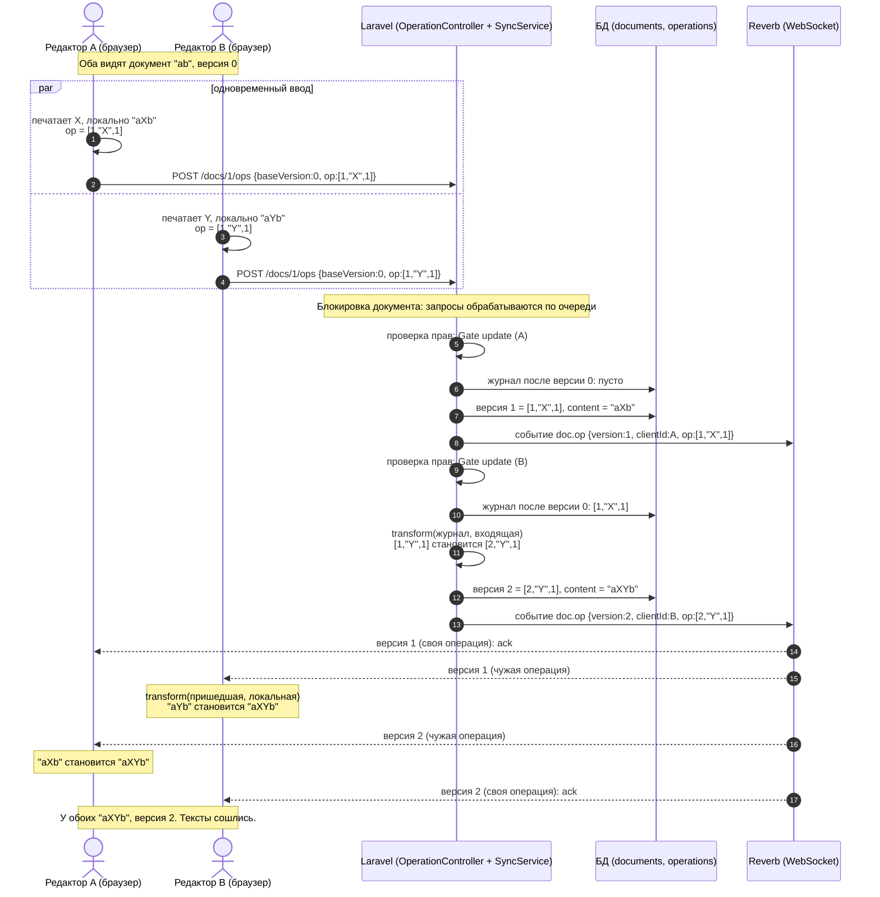
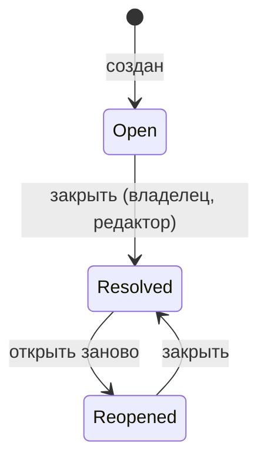
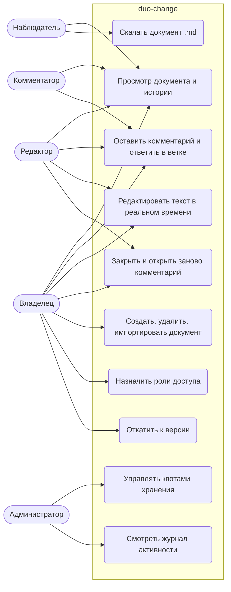
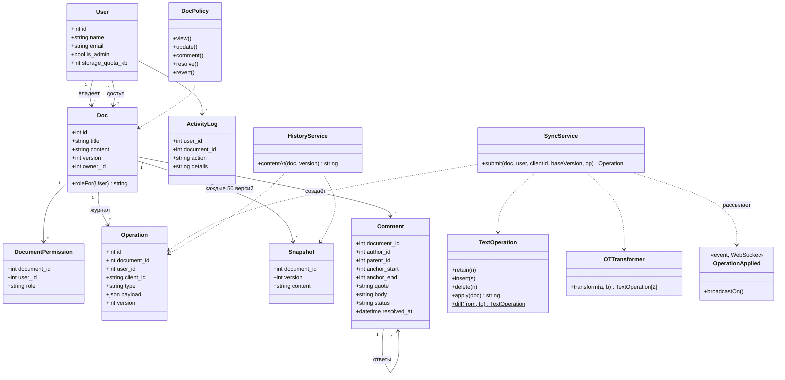

# duoChange

Система совместного редактирования документов в реальном времени.


## Возможности
- [x] Регистрация и вход (сессии)
- [x] Документы с владельцем
- [x] Роли: владелец, редактор, комментатор, наблюдатель, админ
- [x] Совместное редактирование (WebSocket, OT)
- [x] История версий и откат
- [x] Комментарии

## Стек
Laravel 13, Inertia.js, React, Tailwind CSS, SQLite, Laravel Reverb (планируется)

## Запуск
```bash
git clone https://github.com/artzhy064-arch/duo-change
cd collab-docs
composer install
npm install
cp .env.example .env
php artisan key:generate
php artisan migrate
composer run dev
```
Приложение: http://localhost:8000

## Структура
- `app/Http/Controllers` — контроллеры
- `app/Models` — модели (User, Doc)
- `resources/js/pages` — страницы React
- `database/migrations` — схема БД


### Диаграммы duo-change

#### 1. Последовательность: два редактора одновременно вставляют текст



#### 2. Состояния комментария



#### 3. Use Case по ролям



#### 4. Диаграмма классов



## Автор
artzhy064-arch — 2026
